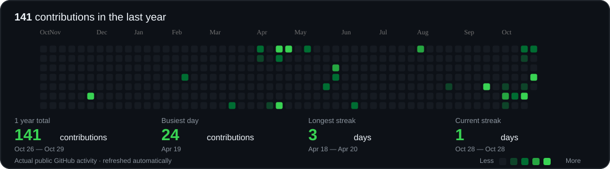

# Hi 👋, I'm Shivam

**I turn user problems into AI-powered products through research, product strategy, and hands-on building.**

📍 India · ✉️ [gptshivam595@gmail.com](mailto:gptshivam595@gmail.com)

---

## Product mindset

<table>
<tr>
<td width="25%" valign="top">

01

### Discover

Understand user problems.

</td>
<td width="25%" valign="top">

02

### Define

Prioritize the right opportunity.

</td>
<td width="25%" valign="top">

03

### Build

Prototype focused solutions.

</td>
<td width="25%" valign="top">

04

### Measure

Learn from data and iterate.

</td>
</tr>
</table>

## Featured product work

<table>
<tr>
<td width="50%" valign="top">

### 🤖 VisualEval Multi-Agent

Evaluates AI-generated fashion imagery through multiple Indian audience perspectives, emphasizing cultural fit and visual relevance.

**AI Evaluation** · **Multi-Agent** · **User Context**

Explore project ↗ 
[github.com/gptshivam595/VisualEval-MultiAgent](https://github.com/gptshivam595/VisualEval-MultiAgent)

</td>
<td width="50%" valign="top">

### 📊 AI B2C Lead Intelligence

Transforms messy B2C lead data into structured insights, prioritized opportunities, and personalized outreach.

**AI Workflows** · **Data Quality** · **Sales Productivity**

Explore project ↗ 
[github.com/gptshivam595/AI-b2c-lead-intelligence](https://github.com/gptshivam595/AI-b2c-lead-intelligence)

</td>
</tr>
<tr>
<td width="50%" valign="top">

### 💬 Customer Feedback Analysis

A prototype for organizing customer feedback into themes that can inform product decisions.

**Customer Insights** · **Product Analytics** · **AI**

View prototype ↗ 
[customer-feedback-analysis-tool.ai.studio](https://customer-feedback-analysis-tool.ai.studio/)

</td>
<td width="50%" valign="top">

### 🗓️ Clinical Staff Scheduling

A workflow-oriented scheduling tool focused on staffing constraints and operational coordination.

**Workflow Design** · **Scheduling** · **Productivity**

Explore project ↗ 
[github.com/gptshivam595/clinical-staff-scheduling-compliance](https://github.com/gptshivam595/clinical-staff-scheduling-compliance)

</td>
</tr>
</table>

## Tools I work with

  

## Contributions

  

  Actual public GitHub activity, refreshed automatically from the contribution calendar.

## Connect

  
  
  
  
  

<em>Build with purpose. Learn through experiments. Make products people love.</em>

